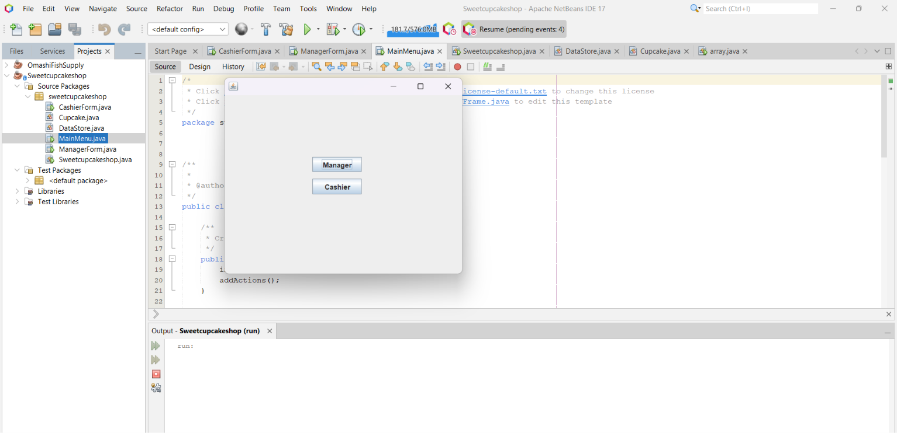
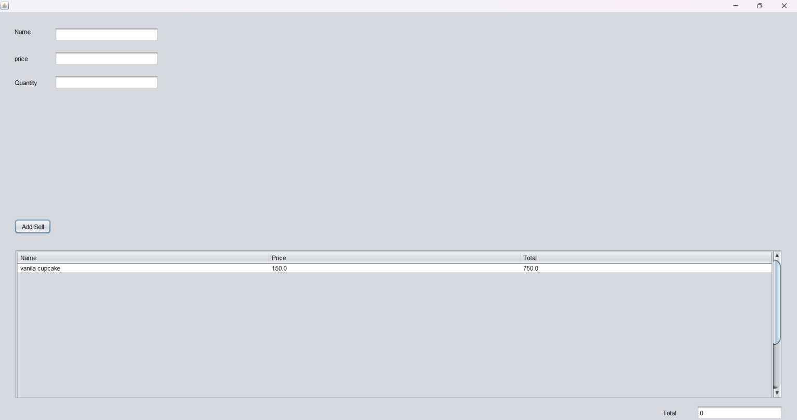

# Sweet Cupcake Shop – Cashier Management System

## Project Overview

Sweet Cupcake Shop is a Java-based cashier management system developed as a software development project using Apache NetBeans IDE.

The project focuses on cashier-related operations for a cupcake shop and demonstrates practical experience in Java programming and desktop application development.

## Technologies Used

- Java
- Apache NetBeans IDE
- Apache Ant build system

## Project Structure

- `src/sweetcupcakeshop/` – Java source code
- `nbproject/` – NetBeans project configuration
- `build.xml` – Build configuration
- `test/` – Project test files

## How to Open the Project

1. Install Java Development Kit (JDK) and Apache NetBeans IDE.
2. Download or clone this repository.
3. Open NetBeans IDE.
4. Select **File → Open Project**.
5. Choose the `Sweetcupcake-shop` folder.
6. Open the project and run it from NetBeans.

## Repository

GitHub: https://github.com/omashi0816/Sweetcupcake-shop

## Screenshots

### Menu

### Cashier Form

### Manager Form

